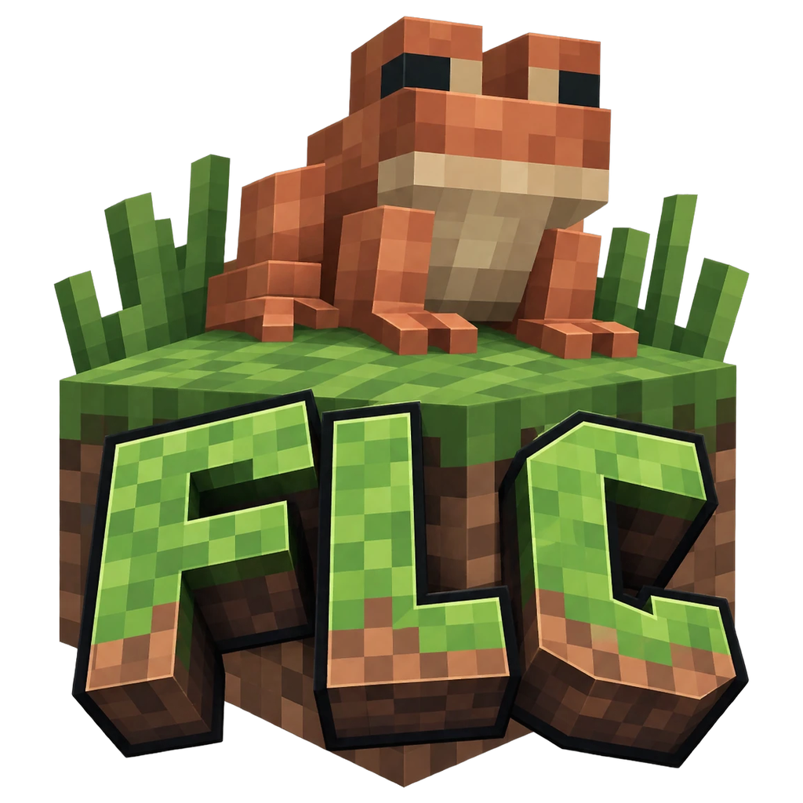
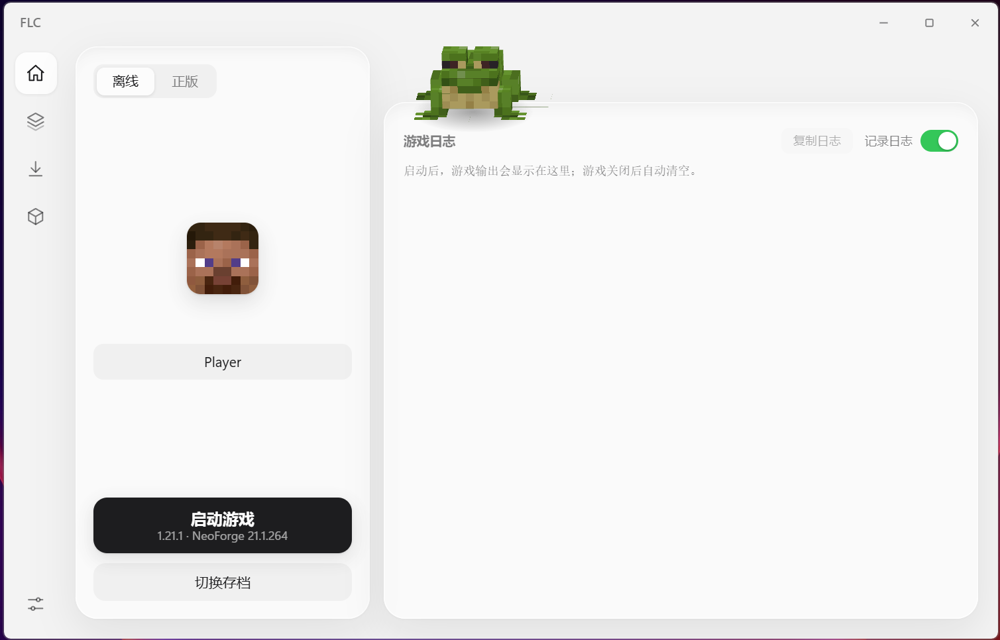
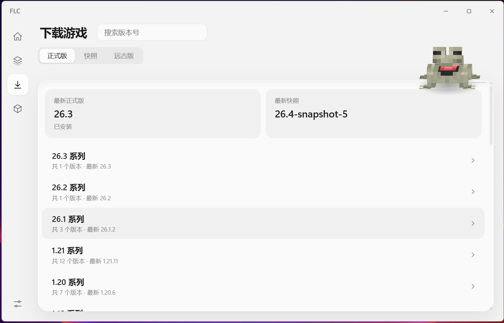
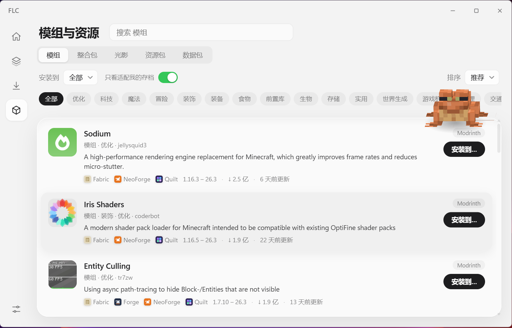
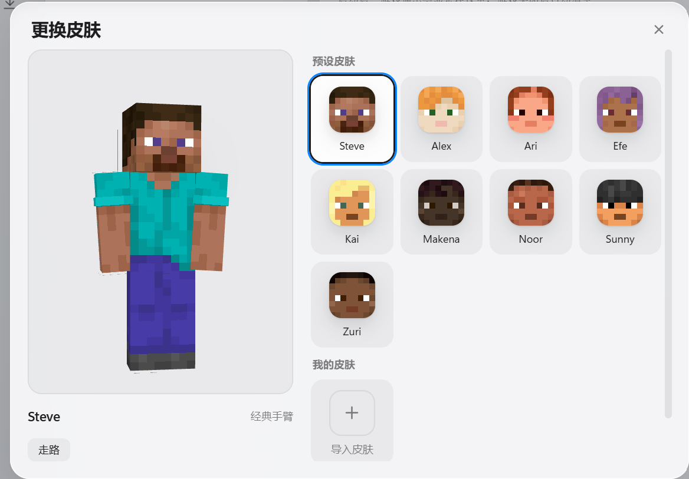

<div align="center">



# FLC · Frog Light Core

**A fast, stable and good-looking launcher for Minecraft: Java Edition**

Tauri 2 + Rust + Svelte · installer-free exe under 16 MB · 16 UI languages

[简体中文](README.md) · [English](README.en.md) · [Website](https://wachg.xyz/flc/)

</div>

> FLC is not an official Minecraft product. It is not approved by or associated with Mojang Studios or Microsoft. Minecraft is a trademark of Mojang Studios. See [NOTICE.md](NOTICE.md).

## Features

**An instance is a whole game**
- A vanilla version and the loader installed on top of it are merged into one entry — no more one version showing up twice.
- Rename each instance, give it an icon (rendered from the vanilla block models and textures, or your own image), and set its own memory, Java, JVM arguments and window size.
- Duplicate an instance with its worlds, mods and config in one click.

**Mods and content from Modrinth**
- Mods, modpacks, shaders, resource packs and data packs: search, sort and filter by category.
- See a mod's required dependencies before installing (already installed / will be installed / no compatible version / optional); required ones are installed automatically.
- Choose which instances to install into. Instances that cannot run the content (wrong game version or loader) are greyed out with the reason.
- Install a `.mrpack` modpack as a new instance, or import a local file.
- Check for updates of mods / resource packs / shaders and update in one click.

**More reliable downloads**
- Parallel downloads with checksum verification; the official source and the BMCLAPI mirror race and fail over automatically.
- A download queue you can cancel at any time. Click the task in the top-right corner to see what is downloading now and what is next.
- The right Java is downloaded and selected for you.

**Loaders**: Fabric, Legacy Fabric, Quilt, Forge, NeoForge.

**Accounts and skins**
- Offline accounts with skin switching: 3D preview, import your own 64×64 skin, nine built-in presets (Steve, Alex, …).
- Microsoft sign-in via the device-code flow (no embedded browser; tokens are stored encrypted with Windows DPAPI). Needs an app Client ID — see below.

**Details**
- When the game crashes, FLC recognizes common causes from the log (out of memory, wrong Java, mod conflicts, GPU driver, …) and tells you what to do.
- Optionally minimize the launcher when the game window appears and bring it back when the game exits.
- 16 UI languages: 简体中文, 繁體中文, English, 日本語, 한국어, Русский, Deutsch, Français, Español, Português (Brasil), Italiano, Türkçe, Tiếng Việt, Polski, Українська, Bahasa Indonesia.
- Windows 11 Mica window material, light/dark follows the system, respects "reduce motion".

## Preview

<table>
  <tr>
    <td width="50%"><br /><sub><b>Home</b>: account, instance and one big Launch button</sub></td>
    <td width="50%"><br /><sub><b>Download</b>: grouped by series, install a loader on the way</sub></td>
  </tr>
  <tr>
    <td width="50%"><br /><sub><b>Mods and content</b>: search Modrinth, choose which instances to install into</sub></td>
    <td width="50%"><br /><sub><b>Skins</b>: 3D preview, presets or import your own</sub></td>
  </tr>
</table>

## Download and use

Download the latest release from [Releases](../../releases):

- `FLC-*-setup.exe`: the **installer** (recommended) with a Simplified Chinese setup wizard. Installs for the current user, no administrator rights needed, creates Start menu and desktop shortcuts.
- `FLC-*-portable.exe`: portable version, just run it.

Windows 10 / 11 with the WebView2 runtime (built in on Windows 11; the installer downloads it if missing, for the portable version install it from Microsoft).

> The installer is not code-signed yet, so Windows SmartScreen may show "unknown publisher" — choose "More info → Run anyway". Checksums are in `SHA256SUMS.txt` on the release page.

First run: **Download** → pick a version (optionally with a loader) → back on **Home**, press **Launch**.

### Microsoft sign-in needs a Client ID

Microsoft requires every sign-in client to use an app ID registered in Azure and approved for the Minecraft services. FLC does not ship a shared ID:

- For yourself: enter your own ID in **Settings → Account → Microsoft sign-in Client ID**.
- For your own builds: set the `FLC_MS_CLIENT_ID` environment variable at build time and the ID is built in.

How to get one: see [docs/构建与发布.md](docs/构建与发布.md) (Chinese).

### How skins work

Offline accounts have no Mojang skin service to query, so FLC packs the selected skin into a resource pack (`resourcepacks/flc-skin.zip`) that overrides the default skins. The texture is always the one you chose, but the arm width (classic / slim) is decided by the game from the player UUID. Microsoft accounts use the skin you have at Mojang.

## Build from source

You need [Rust](https://rustup.rs) (stable), [Node.js](https://nodejs.org) 20+, and on Windows WebView2 and the MSVC build tools.

```bash
git clone https://github.com/<your-username>/frog-light-core.git
cd frog-light-core
npm install

# develop (hot reload)
npx tauri dev

# release build — the UI must be embedded in the exe, so custom-protocol is required
npx vite build
cargo build --release -p flc-app --features tauri/custom-protocol
# output: target/release/flc-app.exe
```

Tests:

```bash
cargo test --workspace
for c in en zh-TW ja ko ru de fr es pt-BR it tr vi pl uk id; do node tools/check-locale.mjs $c; done
```

A command-line front end (no UI, handy for debugging and scripts): `cargo run -p flc-cli -- help`.

## Project layout

```
crates/flc-core   core library: version parsing, downloads, Java, loaders, launching, content (Modrinth), accounts, skins… no UI dependency
crates/flc-cli    command-line front end
src-tauri         desktop shell (Tauri 2): window material, IPC commands
ui                the interface (Svelte 5 + Vite)
  src/locales     translations
tools             translation checker
docs              design notes, build & release
```

## Contributing

Issues and pull requests are welcome — see [CONTRIBUTING.md](CONTRIBUTING.md). Translation fixes, new languages and new crash-diagnosis rules are especially appreciated.

## License

[GPL-3.0](LICENSE) © 2026 蛙创 Studio (Frog Creative Studio)

The repository contains a small number of assets taken from Minecraft (block textures, default skins, the frog model). They belong to Mojang Studios and are not covered by the GPL — see [NOTICE.md](NOTICE.md).
